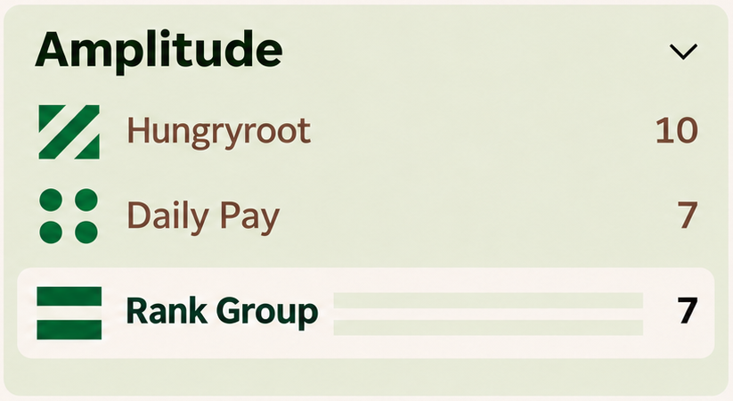
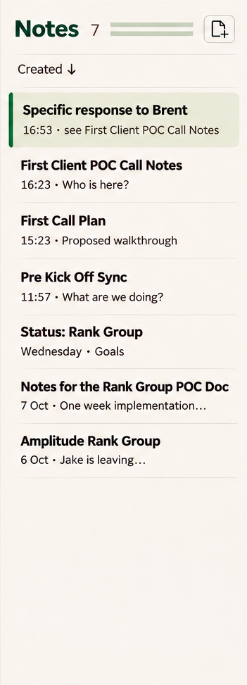

# 01 · Design system and contract identity

**Status:** earth-tone direction and identity principles agreed; square joins and latest placements instructed. Production artwork and exact design tokens remain open.

Evidence: [D26](../sources/decision-record-v26.md) §§15–16, 24, 26, 31; [C01–C04](../sources/chat-amendments.md). The [Field Notes mood board](../images/raw/03-field-notes.png) establishes the creative direction, not every component detail.

## Visual references

Source: [raw 26](../images/raw/26-timer-and-selection-latest.png). The selected contract uses the paper background as a punch-out, with its count at the far right and the quieter repeat in the available row space. This is a complete client-group crop, not an extracted production pattern asset.

Source: [raw 27](../images/raw/27-notes-inline-patterns-latest.png). The repeat belongs in the existing Notes header, not a new decorative row. Context and overflow behaviour are owned by the [notes spec](06-notes-workspace.md).

## Requirements

### DS-01 — Visual direction

**Agreed · D26 §§15–16.** Use green, brown and autumn tones, with red allowed. Keep the playful graphic identity at structural edges: navigation, timer identity, headings and review rows. The writing surface stays quiet. “Owl eyes” describes broad recognition while scanning; it is not an instruction to maximise contrast or cover content in patterns.

The mood-board palette uses chalk/paper, moss, pine, bark, rust and ochre. These are visual references, not a signed-off token file. Engineering/design must settle exact colour values, role-specific foregrounds, tints, borders, focus states and readable combinations before shipping.

### DS-02 — Give identity and state different meanings

**Agreed · D26 §§15, 24–25.** Colour identifies the client; pattern identifies the contract. Selection, focus, running capture, unfinished capture and missing detail have separate treatments. Retain readable client/contract text where context would otherwise be ambiguous. The same contract must be recognisable across sidebar, note context, timer, review and search; small generative differences between renders are not different assignments.

### DS-03 — Square base and continuous repeats

**Agreed · D26 §31.** The source tile is square. Repeated tiles meet edge to edge, with zero gap, zero border and no individually rounded joining edges. Compose wider rectangles by repetition and clipping; do not stretch one tile to fill a long region. A pair of full tiles forms a 2:1 region.

This does not require every motif to form a continuous drawn line across its seam. Outside rounding of a whole component is not settled by the seam rule. The square base supersedes the earlier universal rectangular source canvas.

### DS-04 — Approved and requested placements

**Current instruction · C01–C04; D26 §§24, 31.**

| Surface | Treatment |
| --- | --- |
| Timer identity header | Vertically centred pattern region, cropped at 1.5 square-tile widths; contract above client |
| Selected contract | Primary mark beside label; quiet repeat in remaining row space; count remains at the right |
| Notes list header | Repeat fills available space after Notes/count and before New note |
| Note editor metadata header | Repeat fills available space after Saved and before note-actions ellipsis |
| Time-entry/search identities | Compact contract mark with readable context; no approved background wash |
| Note body | Plain writing surface, without repeated identity background |

These are the current placement instructions. They do not authorise filling every available surface with pattern.

### DS-05 — Relative sizing and spacing

**Current instruction · C01–C04.** Timer mark height was reduced by 15%, then increased by 10% relative to that revised version. Preserve the final intended scale and 1.5:1 crop when selecting real CSS dimensions; do not treat raster pixels as CSS pixels. The latest component image is a composition reference and does not precisely establish the ratio.

Reduce the selected-contract tile-to-label gap by about 40% from the earlier study. Align counts on the right. The latest desktop raster is explicitly unreliable for this gap. A production spacing token and an actual-size review are still needed; do not invent an exact pixel value from the approximate percentage.

### DS-06 — Typography and control consistency

**Direction agreed; measurements open · D26 §§15, 24, 29.** Establish a coherent hierarchy for navigation, document prose, metadata, durations and form labels. Time review should scan densely; the editor should remain comfortable for reading. Reuse control styling across forms and inline edits. No specific font family, type scale, line height, shadow recipe or radius system was approved.

### DS-07 — Production pattern library is deferred

**Deferred · D26 §§26, 31.** The 144-mark sheet is exploratory, not a ready-to-ship library. A random-assignment library is desired, but the initial set, IDs, collision/reuse policy, persistence/migration and user reassignment controls were not signed off. Square geometry and joins are settled; the detailed assignment proposal in D26 §26 was skipped.

Visual consistency across surfaces is required by DS-02. How production assets and assignments achieve that must be settled separately; do not regenerate a visually similar mark independently in each widget.

## Verification and limits

- Render repeat regions with one square source unit at actual UI sizes: no gaps, borders, stretched motifs or rounding at internal joins.
- Check that selection is distinguishable from client grouping and contract identity.
- Check the timer and note can show different contracts without suggesting a mismatch error.
- Review text and controls with keyboard focus, touch, zoom and the muted Time Entries sidebar state. Colour/pattern must not remove names or actionable semantics.
- Check pulse motion with reduced-motion preferences. A non-pulsing running indicator is the engineering fallback; animation timing has not been prescribed.

The checks above are engineering follow-through, not claims that a token system or production tile assets already exist. See [O01–O03](../open-items.md).
