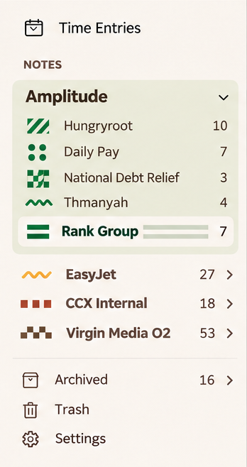
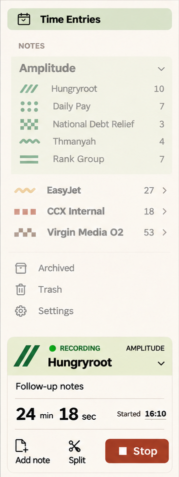

# 02 · Shell and navigation

**Status:** shared visibility, grouping, opacity, collapse and history rules agreed. Exact compact-widget composition and breakpoint values require implementation work.

Evidence: [D26](../sources/decision-record-v26.md) §§4–5, 15, 21, 24, 28; [C01–C04](../sources/chat-amendments.md).

## Visual references

Source: [raw 27](../images/raw/27-notes-inline-patterns-latest.png). Far-right global search outside the search route; no timer reflection when the sidebar timer is visible.

Source: [raw 27](../images/raw/27-notes-inline-patterns-latest.png). **Spacing override:** trust C01/C04 and the [complete component reference](../images/crops/sidebar-selected-contract.png), not the tile-to-text gap shown here.

Source: [raw 12](../images/raw/12-time-review-selected.png). This is the selected looser alignment and opacity reference. **Its timer design is superseded** by [time capture](03-time-capture.md); do not copy RECORDING or the old identity order.

## Requirements

### SH-01 — Shell and layouts

**Agreed / existing behaviour retained · D26 §§4, 24.** Keep the navigation sidebar, notes list and editor on wide desktop layouts. The hamburger can hide navigation, leaving list and editor. Columns are not resizable in this scope. Narrow layouts drill from navigation to list to document. Keep the existing back/forward controls.

### SH-02 — Sidebar hierarchy and selection

**Agreed with current spacing amendment · D26 §§21, 24; C01, C04.** Group a client's contracts within a pale sage/tinted section. The selected contract uses the standard paper background as a punch-out. Remove the decorative colour dot beside the client name. Keep client disclosure and note counts. Flatten single-contract clients as the app already does.

Use the owner-selected looser alignment in raw 12: child marks align within the Amplitude group, while flattened single-contract items retain their different outer inset. Do not reinstate the later rejected universal alignment. Counts align at the right; apply DS-05's smaller mark-to-name gap.

### SH-03 — Mute Notes while reviewing time

**Agreed · D26 §21.** When Time Entries is selected, apply approximately 50% opacity to the entire Notes navigation section, including client backgrounds, marks, headings, names, counts and disclosure controls, plus Archived, Trash and Settings. Keep Time Entries and the timer at full opacity.

This is visual emphasis, not disabled navigation: controls remain clickable, keyboard accessible and semantically enabled. Notes navigation returns to normal opacity when using Notes. Do not apply the opacity recursively so nested elements become 25%.

### SH-04 — One visible timer representation

**Agreed · D26 §§21, 28.** Show a compact timer reflection in the app header when the sidebar timer is not visible. Hide it when either the expanded or collapsed sidebar timer is visible. The rule follows actual presentation, not merely the route name. On the focused mobile capture screen, the full timer is visible and the header reflection is hidden.

The reflection opens access to the same capture. It must show that capture's identity, not the contract currently being browsed. A stopped unfinished entry uses Finish entry, a frozen duration and no running indicator. Do not add a persistent bottom timer bar to the notes workspace.

### SH-05 — Search entry and search route

**Agreed · D26 §30.** Outside the dedicated search route, place global search at the far right of the app bar. On the search route, hide the header search and use one large query input above the results, including while loading or showing no matches. Keep navigation and eligible timer access. See [SR-01](07-search-and-linking.md).

### SH-06 — Collapse and return are presentation actions

**Agreed · D26 §28.** A desktop sidebar timer has a collapse/expand chevron while running and while finishing a stopped entry. Its compact representation includes a clock, contract graphic and client/contract subtitle. Collapse preserves all fields and capture state. A compact sidebar timer still suppresses the header duplicate.

Mobile uses Back to return to the previous work screen. Do not add a second collapse chevron in the focused mobile form. Floating split cards and manual-entry forms have no collapse chevron. Contract selection is a separate action, not the timer chevron's function.

### SH-07 — Preserve orientation through history

**Agreed · D26 §§15, 24, 27–28.** Existing Back/Forward remains the navigation model. Preserve/restore the position within a note when returning through history. Returning from mobile capture restores the previous note or timesheet and its position, while preserving running or unfinished stopped capture. Do not save, discard or resume merely because the user navigates.

### SH-08 — Browsing scope is independent

**Agreed · D26 §§3, 15, 24.** Sidebar selection describes browsing. Timer context describes logged work. A note opened through a cross-contract link must retain its own context. Do not silently change the timer or reassign a note to keep the two contexts visually aligned.

## State matrix

| Situation | Header capture access | Sidebar/focused capture | Result of dismissing |
| --- | --- | --- | --- |
| Desktop sidebar expanded | Hidden | Expanded widget | Chevron collapses; state retained |
| Desktop sidebar collapsed timer | Hidden | Compact widget | Expanding restores fields |
| Sidebar hidden; running | Running reflection | Not currently shown | Navigating does not stop timer |
| Sidebar hidden; stopped unfinished | Finish entry | Not currently shown | Frozen entry remains unfinished |
| Mobile focused capture | Hidden | Full capture form | Back returns to prior work |
| No running or unfinished capture | No active-capture reflection | Existing Start timer/Add entry access | No new idle-state UI specified |

## Acceptance

- Browse Rank Group while timing Hungryroot: note context stays Rank Group, timer stays Hungryroot.
- Hide/show the sidebar and collapse/expand its timer: never show duplicate timer controls.
- Choose Time Entries: Notes and utilities fade as one group but remain operable.
- Stop on mobile, enter details, go Back, reopen Finish entry: frozen end and all details remain.
- Navigate away from a long note and back: restore its prior position without resetting capture.

Exact breakpoint selection, compact visual composition and focus restoration mechanics are [open engineering work](../open-items.md), not inferred from image dimensions.
