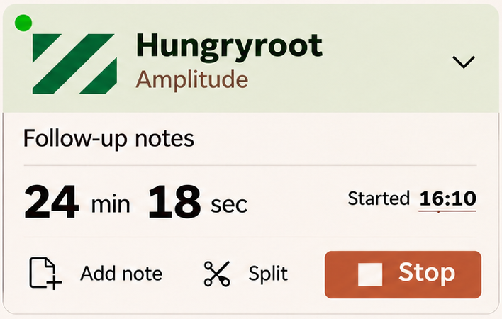
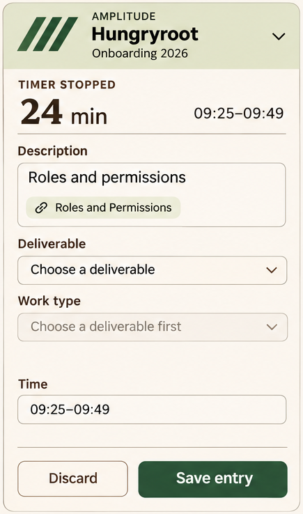
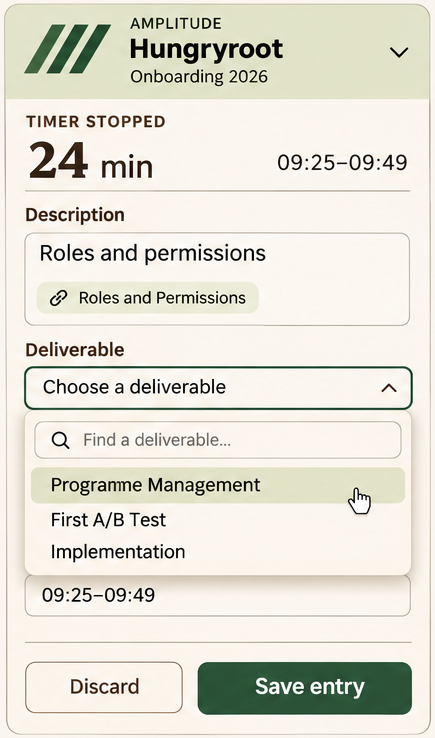
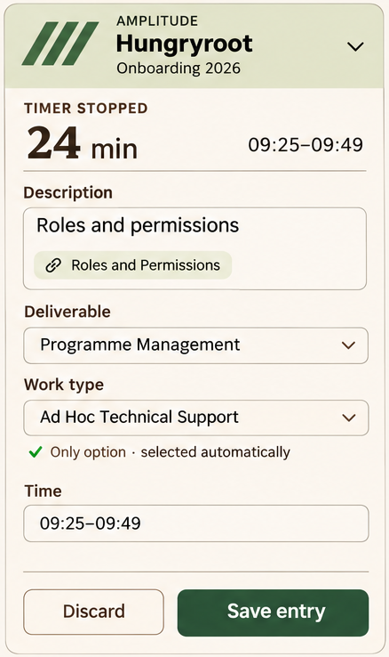
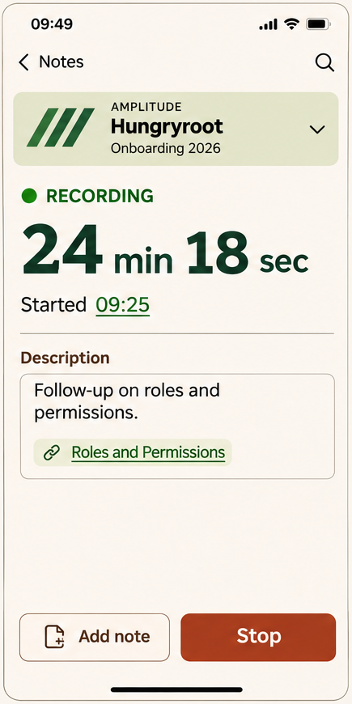
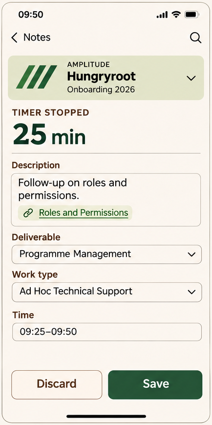
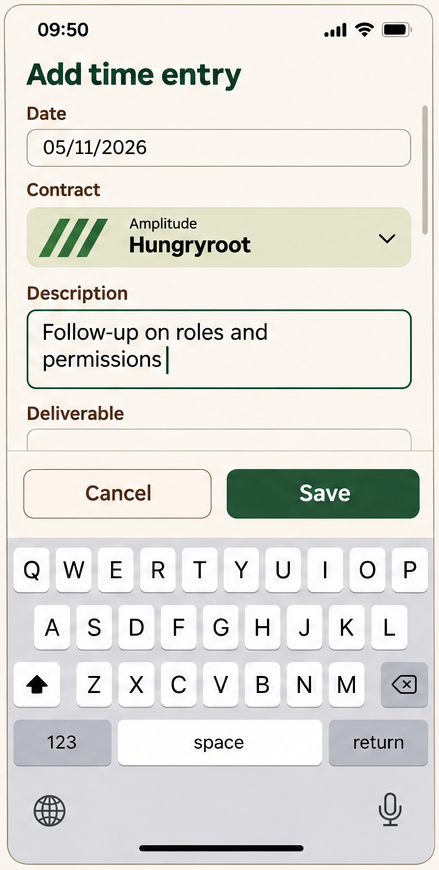

# 03 · Time capture and completion

**Status:** stop/completion, sole-option selection, return state and control wording agreed. Latest timer identity is a current instruction. Mobile composition is a supporting draft with confirmed behavioural corrections.

Evidence: [D26](../sources/decision-record-v26.md) §§7, 16, 20, 27–28; [C01–C04](../sources/chat-amendments.md).

## Running timer

Source: [raw 26](../images/raw/26-timer-and-selection-latest.png).

**Written corrections:** the green pulse light belongs at the **top right**, not top left. The graphic is a vertically centred square repeat clipped at **1.5 tile widths**; the raster is not an exact geometry measurement. Contract appears above client. No RECORDING text. Keep the light and collapse control distinct.

### TC-01 — Start and running state

**Agreed / retained · D26 §§7, 16.** Starting capture can precede contract selection. Keep elapsed time, editable start time, contract choice and description accessible in the sidebar treatment. Classification is completed after stopping. Add note becomes available once a contract is selected.

### TC-02 — Current identity treatment

**Current instruction · C01–C04.** Place the contract name first and the client as subtitle, beside the centred 1.5-unit graphic. Use a pulsing green dot at the top right while running, without the RECORDING string. Use DS-05's relative sizing. The indicator stops representing live capture after Stop.

The desktop chevron collapses the widget; it does not choose a contract. Expose a separate contract-changing affordance. “Change” was suggested, but its exact label/placement remains open. Keep contract selection available before and after a choice.

### TC-03 — Create a note from capture

**Agreed / retained · D26 §§3, 7, 15.** Add note creates a note under the timer's current contract, inserts its stable wiki-link into the description, and navigates to the new note. Do not start another timer. Preserve existing description and references; several notes, including cross-contract notes, can be referenced. An ordinary New note action follows browsing scope instead.

### TC-04 — Stop freezes time immediately

**Agreed · D26 §16.** Stop freezes the end timestamp and opens completion. Time spent describing/classifying does not extend that interval. Present the contract, description, deliverable, work type and time controls from the start of completion in stable positions. Anchor Save and Discard; dependent controls do not pop in sequentially and move the rest of the form.

## Completion and ontology choices

Source: [raw 05](../images/raw/05-stopped-entry.png). **Use Save, not Save entry.** Apply the current contract-first identity and separate contract-change affordance. A sidebar completion widget may collapse; this image does not define the chevron as a selector.

Source: [raw 05](../images/raw/05-stopped-entry.png). Options overlay the form and remain browsable without remembering terminology.

Source: [raw 05](../images/raw/05-stopped-entry.png). **Remove the “Only option” annotation, its icon and reserved helper space.** Automatic selection remains. Use **Save** and **Discard**.

### TC-05 — Dependent choices without layout jumps

**Agreed · D26 §16.**

| Choice state | Required behaviour |
| --- | --- |
| Parent not chosen | Keep the dependent control in position, with a clear pending/disabled explanation |
| Exactly one valid option | Select and show it automatically; continue through subsequent sole-option levels |
| Several valid options | Offer a browsable anchored list; search may assist but is not required to recall choices |
| No applicable options | Show not applicable; do not confuse it with an unchosen parent or loading failure |
| Options fail to load | Preserve existing values and distinguish failure from an empty valid set |
| Parent changes | Keep still-valid descendants, clear invalid ones and apply the same sole-option rule |

Preserve description and wiki links through classification changes. Menus overlay rather than expand the form. Adapt menu placement to available viewport/keyboard space. Do not add “Only option” helper UI or blank space for it.

### TC-06 — Save, Discard and unfinished capture

**Agreed · D26 §§16, 28.** Save commits the capture; Discard resolves it using existing discard semantics. Keep the exact action labels Save and Discard. Retain current required-field/validation rules until source inspection establishes them.

Before resolution there is one unfinished capture. Desktop collapse or mobile Back retains its frozen end and fields; compact access reads Finish entry, without a green running state or incrementing clock. Reopening restores it. Save/Discard clears that access. This is not an automatically saved queue or a general resumable-entry feature.

### TC-07 — Split entry points

**Agreed · D26 §§17, 20.** In a running desktop timer, put the Split icon beside Add note. In the stopped completion form, place Split in the top action/header area. Both open the same desktop two-card operation specified in [Split time](04-split-time.md). No mobile/small-layout Split action. No general Resume action is added to ordinary completion.

## Mobile and manual capture

Source: [raw 19](../images/raw/19-time-capture-mobile.png). **Override:** no collapse chevron, no RECORDING string; apply current contract-first identity and top-right dot. This is a draft of mobile composition, not a newly approved exact size.

Source: [raw 19](../images/raw/19-time-capture-mobile.png). **Override:** no collapse chevron. Back preserves the unfinished stopped entry; it does not resume or resolve it.

Source: [raw 19](../images/raw/19-time-capture-mobile.png). Lower fields remain present in the scrollable form. The depicted enabled Save does not redefine validation. The normal Contract selector can keep its disclosure affordance.

### TC-08 — Mobile presentation

**Behaviour agreed; composition draft · D26 §§27–28.** Show a focused capture surface with Back to the originating work screen and no duplicate header timer. Running capture has Add note and Stop; stopped capture has the full completion form and Save/Discard. Keep local actions accessible above the keyboard/safe area without covering focused fields. These local actions do not create a global bottom timer bar on notes.

### TC-09 — Manual entry

**Retained workflow with shared styling · D26 §§7, 27.** Keep manual Add Time Entry as its existing modal workflow: Date, Description, Contract, dependent classification and the existing duration/range input. Use the same choice rules and control styling. Desktop is a centred overlay; narrow layouts must fit/scroll around the keyboard. Use Cancel and Save, not the stopped-capture Discard label. Manual entry does not silently change a running timer.

## Acceptance

- Stop at a known instant; spend two minutes filling the form: saved end remains the stop instant.
- Choose a branch with one deliverable and one work type: both fill automatically with no helper badge.
- Switch contract: preserve valid dependent choices; clear incompatible ones; description and links survive.
- Open a long option list on a short mobile viewport: focused control and local actions remain reachable.
- Back out of unfinished completion, navigate, reopen: fields and frozen time survive.
- Create a note from a Hungryroot timer while browsing Rank Group: create/link under Hungryroot.

Save failure, persistence across app restart, exact validation and how manual-entry concurrency is currently handled require [source inspection](08-integration-and-verification.md); this pack does not claim those mechanisms already exist.
