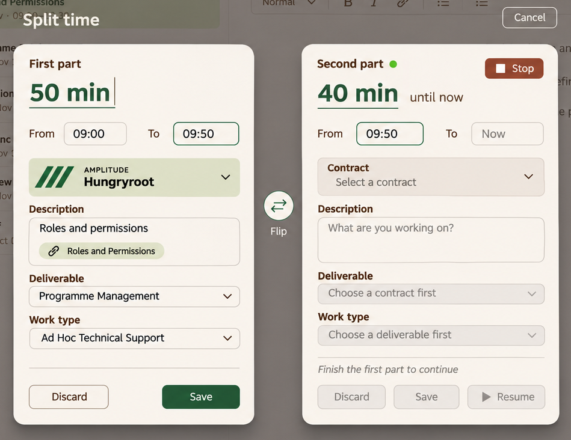

# 04 · Split time

**Status:** desktop two-card flow and cancellation-on-resize rule agreed. Only the initial two-card state was rendered. The resolved-left summary is a written requirement, not a missing approved image.

Evidence: [D26](../sources/decision-record-v26.md) §20, superseding §§17–19; §28 for collapse controls.

## Visual reference

Source: [raw 10](../images/raw/10-split-two-cards.png). The background app is incidental. No enclosing dialog or shared footer; no slider or repeated splitting. Apply current shared field/identity styling without importing a collapse chevron into either card.

## Requirements

### SP-01 — Desktop-only single split

**Agreed · D26 §20.** Offer one split into two chronological parts. Two independent cards float side by side above the dimmed app, with a modest Split time label, floating Cancel and a Flip control between them. No fullscreen editor, enclosing card, shared save footer, multi-split or mobile split. Both running and stopped capture can enter this flow.

### SP-02 — Time slots and shared boundary

**Agreed · D26 §20.** The left card emphasises editable duration and From/To. The right emphasises elapsed duration through Now while running, and has From/To plus Stop.

Before the left is resolved, left To and right From represent one shared boundary. Editing either updates both. Changing the left duration moves that boundary from its start; changing the right duration moves it back from its endpoint. Outer start/end values remain editable. These are adjacent intervals while linked, not two independently drifting boundaries.

Confirm a typed duration against Now using the confirmation instant, then keep the resulting start timestamp fixed while live elapsed time grows. Do not keep moving the boundary on every tick or while the user types. Reject zero/negative intervals. Retain existing parsing/precision rules pending source inspection; this does not settle midnight, timezone or overlapping-other-entry policy.

### SP-03 — Flip content, not chronology

**Agreed · D26 §20.** Keep the original description, links and classifications together. The new part starts blank, including contract. Flip swaps those content packages between the earlier and later slots; it does not exchange timestamps or reverse chronology. Apply the approved dependent-choice rules only after their required parent is selected.

### SP-04 — Resolve the left first

**Agreed · D26 §20.**

| Stage | Left card | Right card | Shared controls |
| --- | --- | --- | --- |
| Both unresolved | Editable; Save/Discard active | Editable; live Stop active; Save/Discard/Resume disabled | Flip and Cancel available |
| Left Save succeeds | Saved summary in same footprint | Save/Discard/Resume unlock, subject to existing validation | Flip and Cancel removed |
| Left Discard succeeds | Discarded summary in same footprint | Same unlocking | Flip and Cancel removed |
| Left Save fails | Still unresolved; all fields retained | Remains editable, completion actions still locked | Cancel/Flip remain |

Left Save commits only that interval. Left Discard intentionally leaves it unlogged. Keep the resolved summary's footprint so the right card does not jump. A concise reason can explain the disabled right actions.

After resolving the left, its boundary is fixed for that result. The remaining right start may subsequently be edited normally without changing an already saved left entry. Do not silently rewrite the completed interval.

### SP-05 — Right Stop, Save, Discard and Resume

**Agreed · D26 §20.**

| Action | Effect |
| --- | --- |
| Stop | Freeze the live right endpoint immediately; clear running state; do not save |
| Save | Commit the right interval; freeze Now if still live, otherwise use the fixed end |
| Discard | Resolve/remove only the remaining right portion |
| Resume | Return the unsaved right portion to ordinary active capture, starting at its configured start |

Save/Discard/Resume are available only after left resolution. Stop may be used before it. If the source was already stopped, the right starts stopped and has no active Stop action.

Resume from a stopped right portion includes the entire interval through the current time, including editing time. It may proceed without a contract, consistent with ordinary timer start. This is continuation of the unsaved remainder, not resuming an entry that has already been saved. Resolving the right closes the overlay; no unfinished left draft remains.

### SP-06 — Cancel and dismissal

**Agreed · D26 §20.** Before left resolution, Cancel abandons the proposed split and restores the original unsplit content/range. Preserve elapsed time if still running. Preserve an explicit Stop performed inside the split instead of restarting capture. Do not create either provisional entry.

After left resolution, remove Cancel because the completed action stands. Escape and backdrop dismissal must obey the same guard; they cannot bypass left-first completion or undo a committed left entry. Finish the right through Save, Discard or Resume. No collapse chevrons belong in the cards.

### SP-07 — Resize from large to small

**Agreed with recorded partial-commit interpretation · D26 §20.** Cancel the split UI when crossing into the small layout; do not stack the cards.

| State at breakpoint crossing | Required outcome |
| --- | --- |
| Left unresolved | Restore unsplit capture as normal Cancel would; preserve elapsed time or explicit Stop |
| Left already saved/discarded | Preserve that result; return the remaining portion and its fields to ordinary capture/completion |
| Save in flight | Settle the outcome once, then use the corresponding branch; no duplicate commit or orphaned remainder |
| Window grows again | Do not reopen the split automatically |

A running remainder stays running. A stopped remainder stays unfinished and stopped; resize must not invoke Resume. Use the app's applicable small-layout breakpoint; no pixel threshold has been chosen.

### SP-08 — Persistence boundary

**Agreed implementation requirement · D26 §20.** Persist left resolution and advancement of the source capture to the remainder together, so an interruption does not duplicate the original full interval or lose the right portion. A failed save retains form data and unresolved state. The mechanism must be established against the actual persistence layer; no transaction support is assumed here.

## Acceptance scenarios

1. Running 09:00→Now, boundary 09:50: left is 09:00–09:50; right is 09:50→Now. Changing either shared endpoint updates both before resolution.
2. Flip once: original description/links/classification move to the other slot; times stay chronological.
3. Enter new text on the right, then attempt Resume before left resolution: it remains unavailable. Right Stop still works.
4. Save left, then edit the right start: saved left remains unchanged; Flip/Cancel are gone.
5. Stop right, then Resume after resolving left: elapsed span continues from right's configured start through current time, including form-editing time.
6. Cancel before resolution after pressing Stop: restore an unsplit stopped completion, not a restarted timer.
7. Resize before resolution, after left Save, after left Discard and during Save: preserve exactly the corresponding committed result and live/stopped remainder.

No splitting of an arbitrary saved entry or duration-only historical entry is added by this spec. Those capabilities would need separate scope and source review.
