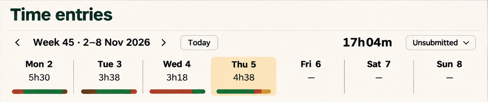
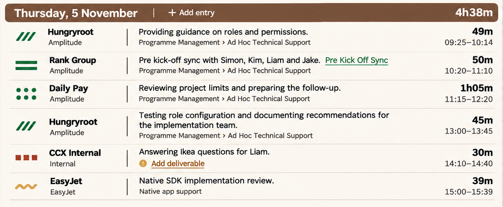
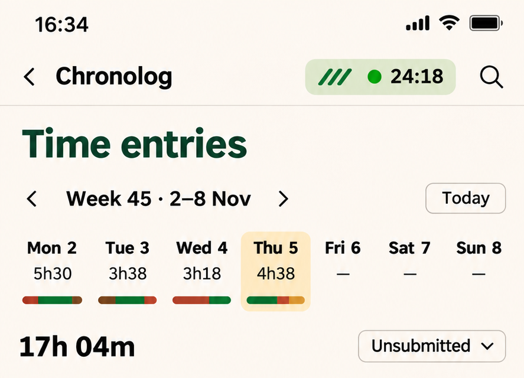
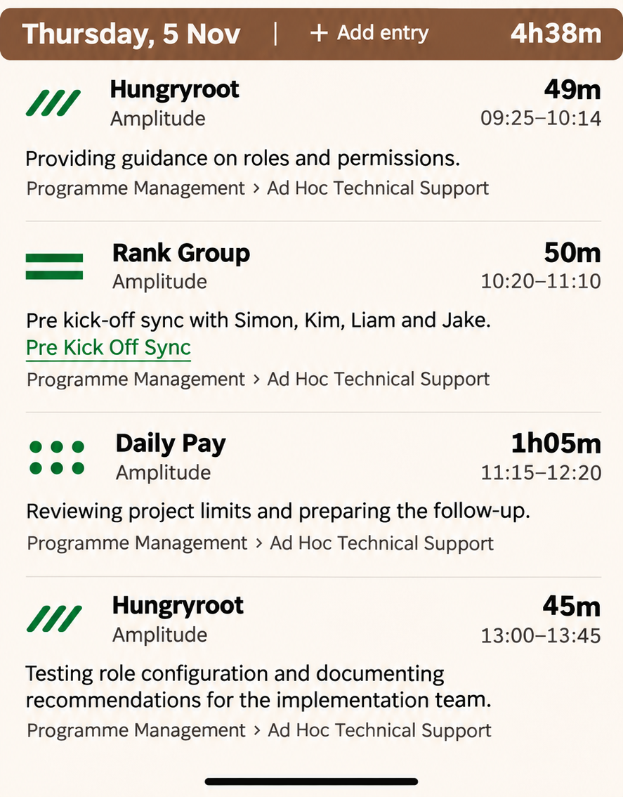

# 05 · Time review and inline editing

**Status:** owner-selected sidebar treatment and explicit review refinements are banked. The wider review composition and mobile adaptation are recorded visual studies; exact spacing and the divider geometry remain unresolved.

Evidence: [D26](../sources/decision-record-v26.md) §§8, 15, 21–22, 29.

## Visual references

Source: [raw 12](../images/raw/12-time-review-selected.png). **Week numbering must count from the start of the calendar year.** The sample Week 45 label is not a specification of partial-week or year-boundary rules.

Source: [raw 12](../images/raw/12-time-review-selected.png). **Square off the brown bar ends at content edges. Horizontal separator endpoints remain open; the full-width lines in this crop are not authoritative.** Duration and description examples are illustrative.

## Requirements

### TR-01 — Compact week overview

**Banked direction · D26 §§15, 21.** Put weekday and date together on one line, duration below, with a thin segmented client-colour breakdown. Align week navigation, Today, week total and status consistently. Keep all seven days available. Clicking a day scrolls to its heading; it is not a date filter.

Use actual entry data for totals and segment proportions. The generated strip colours/proportions are approximations, not a calculation fixture.

### TR-02 — Sticky day headings

**Agreed direction and amendment · D26 §§21–22.** Make the current day heading visually prominent in bark brown with date, day total and a local Add entry action. Keep it visible below the week controls while that day's entries scroll. Day-jump offsets must account for the actual header heights.

Where a brown heading bar meets the screen/content edge, use square ends/corners. The owner's “week heading bars” correction refers to these date/day bands. Do not retain the rounded caps shown in the mockups.

### TR-03 — Aligned desktop entries

**Banked direction · D26 §21.** Use a stable contract-identity column, flexible description with classification beneath, and right-aligned duration/time. The contract mark and readable contract name should support broad scanning. Preserve chronology; do not regroup or sort by client to achieve visual grouping. Wrap long descriptions.

Use the shared contract pattern system; do not adopt the exploratory repeated background wash. A saved entry remains editable in place.

### TR-04 — Divider refinement remains partly open

**Owner instruction; geometry open · D26 §21.** Preserve the exact intent:

> “the horizontal dividers for time entries could collapse to the left of the client name … same clients … dividers will line up … maximises space.”

Shorten/reposition horizontal separators to support identity alignment and reclaim space. The exact start/end points are not established by this wording or the raster. Do not reinterpret this as approval of a new vertical separator or automatic client grouping. Resolve the geometry in an actual layout review before calling it complete.

### TR-05 — Missing detail is local

**Agreed · D26 §§15, 21.** Flag missing information at the affected field/entry, with an appropriate inline action such as Add deliverable. No Needs details filter, completion queue or separate review workflow. Keep the existing validation and meaning of missing fields until inspected.

### TR-06 — Preserve field-level inline editing

**Agreed; control details delegated to engineering · D26 §29.** Click/tap a field to edit it in place: text for description, selectors for contract/classification, direct time editing. Use shared styling and subtle hover/focus cues; mobile must work without hover.

Keep neighbouring rows and columns stable. Necessary text expansion is allowed; opening a dropdown must not reflow the list. Preserve readable identity and link behaviour while editing other fields. Do not introduce a whole-entry modal, separate edit mode or Save all.

Retain existing dependencies, validation and commit/cancel behaviour. Blur-to-save, Enter/Escape semantics, save timing and error handling have not been newly specified; inspect the current code and resolve them as engineering details.

### TR-07 — Week status and numbering

**Agreed / retained · D26 §§8, 21.** Each week has Unsubmitted, Draft ready or Submitted status. It is recordkeeping only. Choosing Submitted does not send, export, invoice or trigger another action.

Weeks count from the start of the calendar year. The first partial week, week start convention at rollover and ownership of a week spanning years remain to be specified. Do not silently substitute an ISO week-number library convention.

### TR-08 — Mobile review

**Responsive draft with agreed constraints · D26 §22.** Keep the seven-day strip compact. Reflow each entry into an identity-and-time line, then full-width description/classification. Keep contract name and motif together; use smaller client text; align duration and range to the right. Wrap rather than squeeze long prose.

Retain sticky day context, inline editing, chronological order and local missing-detail cues. The absent sidebar permits compact timer access in the header. No mobile Split and no persistent bottom timer bar.

Source: [raw 14](../images/raw/14-time-review-mobile.png). **Square brown heading ends and unresolved separator geometry override the image.** This is a responsive reference, not a claim that all narrow-layout measurements are approved.

## Acceptance

- Scroll a long day: its heading remains under week controls; the following day replaces it at the correct boundary.
- Jump via a day cell: its heading and first entry are not covered by sticky UI.
- Mix several Amplitude contracts: each keeps a distinct mark and readable contract name without changing chronology.
- Edit description/classification/time: preserve field-level behaviour and steady surrounding rows.
- Toggle Submitted: only the selected week's recordkeeping status changes.
- Verify short/long descriptions, duration-only rows and missing classification without inventing a time range.

The final separator layout and year rollover examples are [O04–O05](../open-items.md). No app-level test has yet been run.
