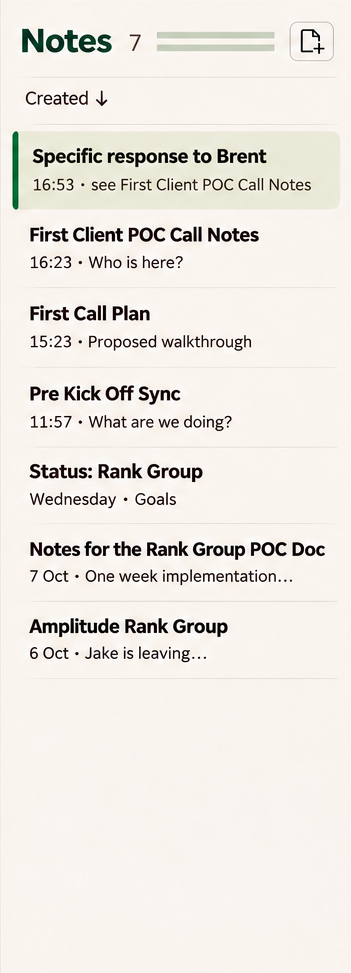
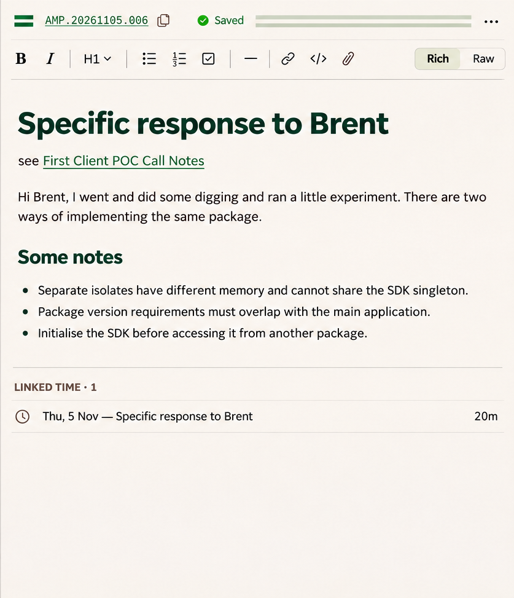
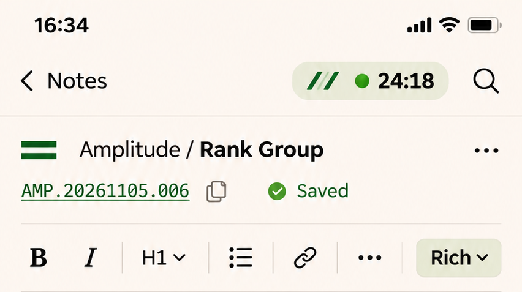
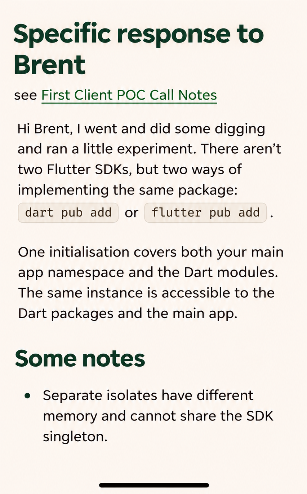

# 06 · Notes workspace

**Status:** desktop and mobile notes treatment approved in D26. Inline pattern placement and sidebar-spacing corrections are later instructions.

Evidence: [D26](../sources/decision-record-v26.md) §§6, 24; [C01–C04](../sources/chat-amendments.md).

## Visual references

Source: [raw 27](../images/raw/27-notes-inline-patterns-latest.png). Repeat occupies the existing Notes/count/New note row. **Do not restore the separate pattern row from raw 25.**

Source: [raw 27](../images/raw/27-notes-inline-patterns-latest.png). Repeat sits after Saved and before the ellipsis. **No second pattern row below the formatting toolbar.** The shortened note content is illustrative; no content rewrite is authorised.

## Requirements

### NT-01 — Context ownership across layouts

**Agreed · D26 §24.** Remove redundant client/contract naming across all three desktop columns while retaining enough context in every layout.

| Layout/context | Where readable scope belongs |
| --- | --- |
| Three columns, one selected contract | Sidebar owns the selected client/contract; list uses Notes/count; editor uses mark/code/status/actions |
| Navigation hidden; list + editor | Restore necessary client/contract context in the list header |
| Single-column note | Note header identifies its own client/contract |
| List spans contracts | Each row identifies its contract; editor retains the opened note's identity |
| Link opens another contract | Reflect the actual opened note, without borrowing the timer's identity or leaving misleading scope |

The exact repeated-pattern choice in a multi-contract list is not settled. Do not assign the timer's pattern to the list as an implicit default. See O07.

### NT-02 — Notes list

**Agreed · D26 §24.** Header contains Notes, count, a New note icon and the existing Created sort control. Provide New note as its accessible name and tooltip without shrinking its usable target. Keep title, date/time and excerpt in each row; omit repeated contract text only for a single-contract list. Selected note uses a quiet sage fill and narrow pine edge.

New note retains browsing scope and existing creation behaviour. It does not inherit the timer contract. Timer Add note is the separate capture action in TC-03.

### NT-03 — Inline identity repeats

**Current instruction · C02.** Fill available width between Notes/count and New note with the contract repeat. Fill available width after Saved and before note-actions ellipsis in the editor header with the repeat. Do not insert dedicated rows under sort controls or formatting.

Use the square, edge-to-edge repeat from DS-03. The motif must not crowd or overlap functional controls. On narrow/mixed-context layouts, exact clipping/omission behaviour still needs layout resolution; the instruction does not authorise reducing control targets or obscuring names.

### NT-04 — Metadata and note actions

**Agreed · D26 §24.** Keep the contract mark and copyable note code together. Code and adjacent copy icon invoke the existing Copy note code operation. Use a quiet Saved check/label while preserving real saving/failure states.

Move existing Move, Export and Delete into the note-actions ellipsis menu, preserving their actual behaviour and confirmations. The document title appears in the body, not duplicated in another local title bar. A menu's accessible name must identify it as note actions.

### NT-05 — Formatting and raw mode

**Agreed · D26 §24.** Desktop groups bold/italic, heading styles, list/check controls, rule, link, code and attachment, with Rich/Raw at the right. Retain existing H1/H2/H3 and normal text choices. Grouping must not remove existing capabilities.

Mobile keeps core formatting visible and uses a formatting overflow for the rest; Rich opens the Rich/Raw choice. Distinguish formatting overflow from note actions. Preserve editor selection/focus through menu use. Rich/raw conversion, title extraction and attachment behaviour stay as implemented unless source review exposes a specific issue.

### NT-06 — Linked time and quiet writing

**Agreed · D26 §24.** Keep linked time secondary, with actual entry identities, including contract context when different from the note. No timer controls are added there. Use the shell's single-visible-timer rule and no global bottom capture bar. Existing links remain clickable; insertion via the picker is not immediate navigation.

### NT-07 — Mobile note layout and return

**Agreed · D26 §§24, 28.** Single-column editing restores note context and compacts formatting controls without dropping capabilities. Header timer access is available when the sidebar timer is absent and shows the independent capture identity. Back/Forward and returns from capture restore note position per SH-07. Safe areas and keyboard geometry are implementation constraints, not image measurements.

Source: [raw 16](../images/raw/16-notes-mobile.png). These show the approved mobile hierarchy before the later inline-repeat request. The narrow placement of that repeat has not been separately rendered; preserve control space and readable context.

## Acceptance

- Three-column single-contract view avoids repeating the same client/contract label in all three headers.
- Hide navigation: readable context returns; note list and editor remain correctly scoped.
- Open a cross-contract note while another contract's timer runs: both identities remain correct.
- Copy code, Move, Export, Delete and Rich/Raw remain available with their existing semantics.
- New note icon and Timer Add note create in their respective contexts.
- Header repeats use existing rows; body prose and linked-time region remain quiet.

Unrendered states include two-column/mixed-contract layouts, open action menus, raw mode in the new shell, saving/failure and narrow inline-repeat fit. They are implementation coverage, not additional approved mockups.
