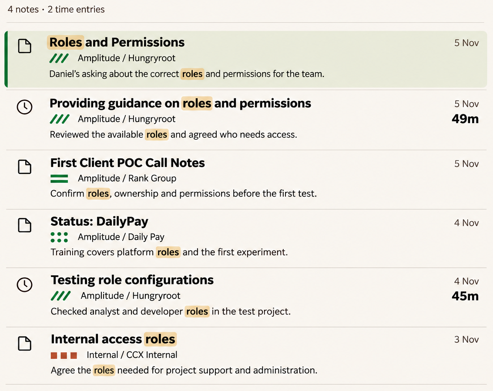
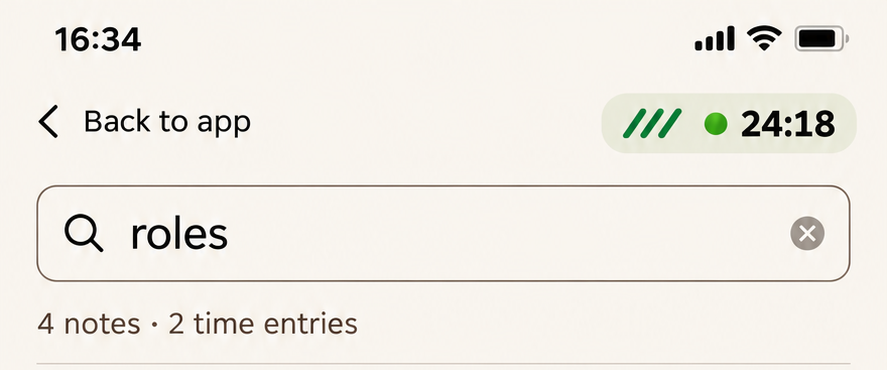
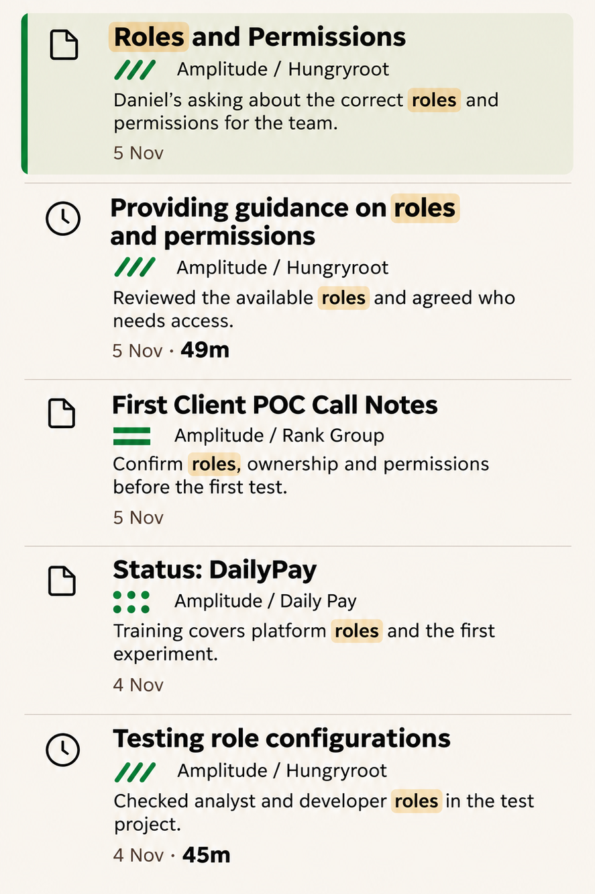
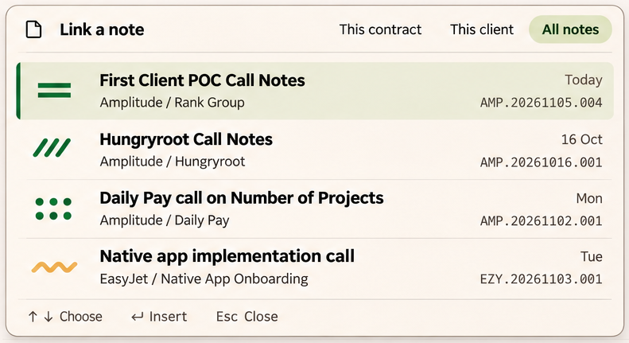
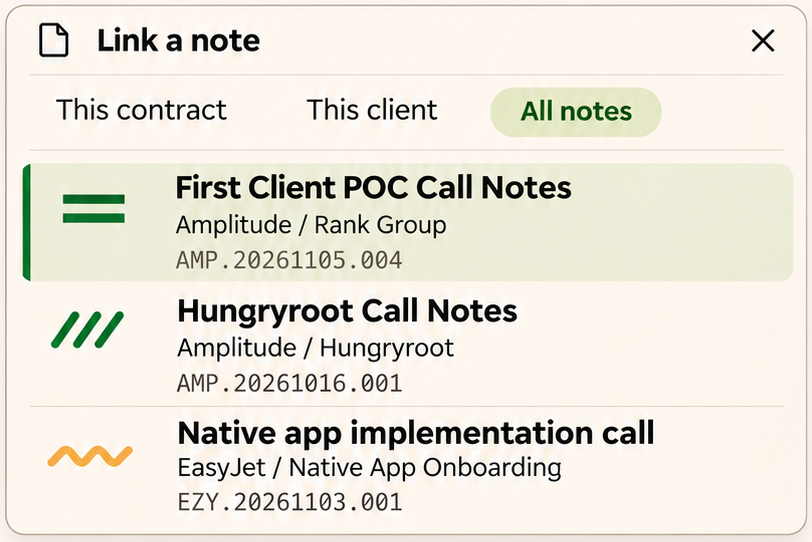

# 07 · Global search and wiki-link picker

**Status:** desktop/mobile search approved with query-placement amendment. Picker banked with its visible header and all scope controls removed. Shared matching behaviour agreed; exact algorithm and linkable types need source inspection.

Evidence: [D26](../sources/decision-record-v26.md) §§9, 25, 30.

## Global search

Source: [raw 20](../images/raw/20-search-desktop.png).

**Placement override:** add one large query input directly above these results and hide the app-header search on the search route. Raw 20 still shows the superseded top-right input; the crop is a result-list reference, not evidence of the final input placement.

Source: [raw 21](../images/raw/21-search-mobile.png). This shows the approved large query location. The dismissed keyboard is an illustrated state, not an automatic dismissal requirement.

### SR-01 — One query field on the search route

**Agreed · D26 §30.** Outside search, use the far-right app-header entry point. Once routed to search, show a prominent query input above the results, spanning the results column/available mobile content width. Hide the header search and do not reserve its old space. Apply the rule to loading, empty and failure states as well as populated results. Preserve the query through routing and provide a smooth typing/focus handoff.

Keep navigation and eligible compact capture access. On mobile the navigation row has Back to app and capture access, without another search icon/input.

### SR-02 — Mixed results with recognisable identity

**Agreed · D26 §30.** Mix notes and time entries in one list. Lead with note title or time description and a document/clock type icon. Follow with the contract mark and readable client/contract label, then the matching excerpt with restrained ochre highlighting.

Desktop uses quiet right-aligned dates and readable time-entry durations. Mobile moves date/duration beneath the excerpt and wraps text. Use consistent separators; the active result may use sage fill and a pine edge. Preserve existing result-opening behaviour. Sample counts, dates and ordering are not a ranking formula.

### SR-03 — One shared query algorithm

**Agreed · D26 §25.** Global search and the inline picker use the same query interpretation, matching and ranking implementation. Include owning client/contract metadata as searchable content, so records can match a client/contract name even if it never appears in their title/body.

Combine identity and content terms without requiring a special filter syntax. For the same candidate type and query, matching/order should be consistent across both surfaces. Surface-specific supported types and result limits may differ. Do not apply a hidden current-note, sidebar or timer-contract restriction.

| Query/context | Required property |
| --- | --- |
| Amplitude | Finds associated records even with no “Amplitude” in the record text |
| Hungryroot roles | Combines contract identity with relevant searchable roles content |
| A note's stable code | Still finds that note |
| Picker in Rank Group while timing Hungryroot | Neither context silently restricts the global candidate set |
| Metadata-only match | Shows correct matching context; does not invent a highlighted body excerpt |

Tokenisation, prefix/partial matching, ambiguous names, weights, tie-breaking and query syntax edge cases remain open. This requirement is not approval of a particular parser or scoring function.

## Inline wiki-link picker

Source: [raw 17](../images/raw/17-link-picker-desktop.png).

**Mandatory override:** remove Link a note, its dedicated header icon, and This contract / This client / All notes controls. Start the panel directly with results. Do not add a second input. “Global search only” means global matching inside the picker, not navigating to the search page.

Source: [raw 18](../images/raw/18-link-picker-mobile.png). **Remove the header, close control and scope row without leaving a blank band.** The whole panel is retained in this crop so the superseded controls are visible and traceable.

### SR-04 — Entry point, query and candidate types

**Agreed · D26 §25.** Typing [[ opens recent-note suggestions at the active insertion point. Continue query typing in the editor or supported time-entry description. Use SR-03's global matching; no scope tabs, dropdown, remembered scope or implicit contract filter.

Confirm actual linkable target types in source. Global search already includes notes and time entries; that does not establish time entries as wiki-link targets. Preserve existing supported types and identify them clearly if more than one exists. New target capabilities are separate scope.

### SR-05 — Result hierarchy

**Agreed · D26 §25.** Lead with readable title, then contract mark and client/contract context. Keep stable code quiet and secondary. Desktop can align code/date at the right; mobile can stack code and omit date. Selected result uses a separate sage fill/pine edge, not a new contract pattern. Give the popup an accessible name without restoring a visible heading.

### SR-06 — Insertion and dismissal

**Agreed · D26 §25.** Arrow keys move the active result; Enter, click or tap inserts. Replace only the active [[ query token with the existing canonical wiki-link representation and place the caret after it. Preserve editor focus, undo behaviour and the mobile keyboard. Inserting does not navigate to the target.

Escape/outside interaction closes suggestions without deleting typed text. Leaving the token or navigating away closes the panel. Preserve the insertion range during result interaction. Do not prematurely complete the token to imitate a generated bracket/underline in the image.

### SR-07 — Placement and async states

**Agreed · D26 §25.** Desktop autocomplete anchors to the active query, flips/constrains near viewport edges and scrolls results internally without dimming/reflowing the document. Mobile places results above the software keyboard, keeps the active query visible and uses available space when there is no software keyboard.

No mobile shortcut footer, removed header or scope rows. Typing remains independent of loading. Distinguish loading, no matches and failure; keep the query on error and ignore stale responses from older queries.

## Acceptance

- Run the four query/context examples in SR-03 against the same candidate type on both surfaces.
- Open the picker with no query: recent notes; type client/contract terms: global matching with readable identity.
- Insert with keyboard and touch: correct token replaced, caret retained, no navigation, undo still works.
- Dismiss without selecting: typed query remains. Quickly change query: older responses cannot replace current results.
- Search route with zero results or loading: exactly one large query input remains above the result area.

Exact search semantics and candidate types are [O08–O09](../open-items.md). Result counts/caps and indexing behaviour must be inspected rather than inferred from the examples.
