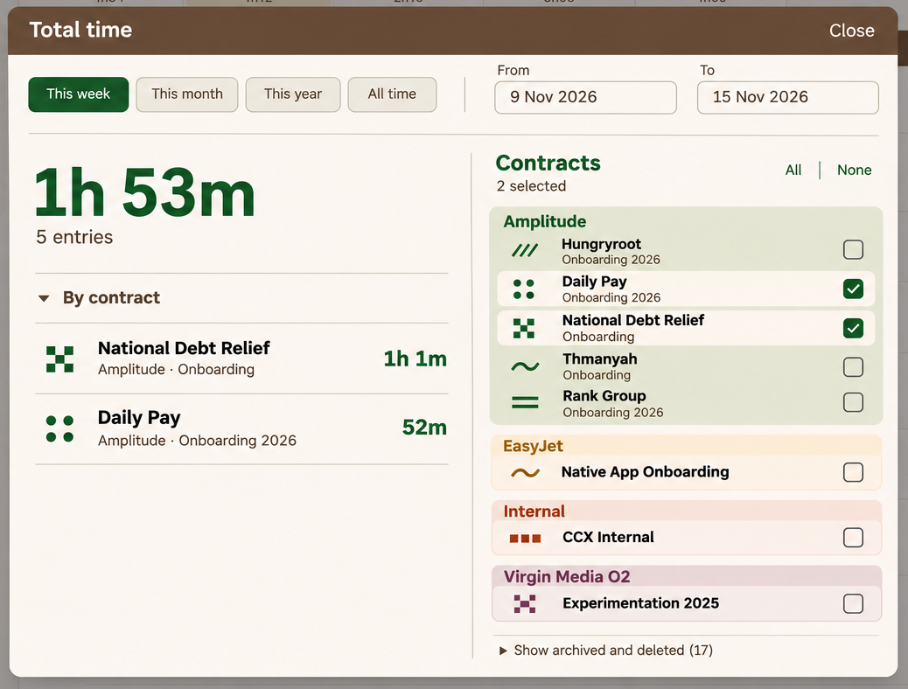
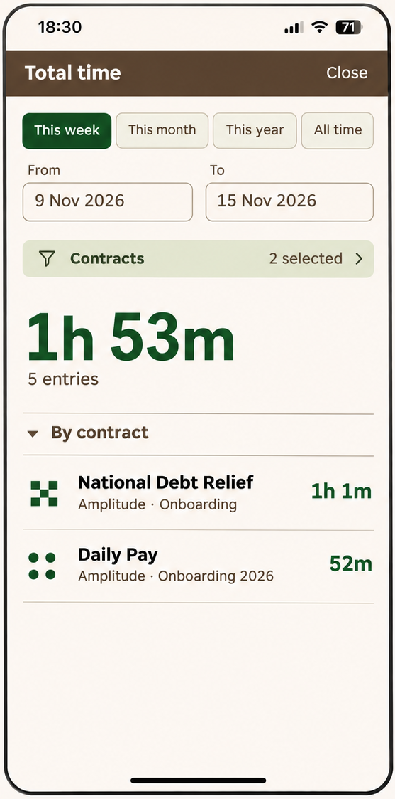
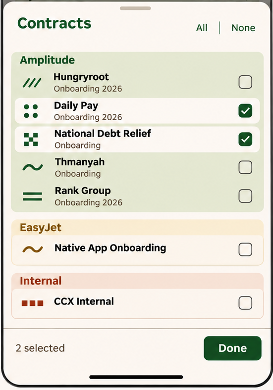

# Total time — UI specification

**Status:** approved mobile and desktop design direction. Behaviour below consolidates the approved explanation; supporting states and integration details are engineering requirements.

## 1. Purpose and scope

Show the total logged time and entry count for a chosen date range and set of contracts, with a per-contract breakdown. Keep the result prominent and the controls compact. Reuse the existing Total time route and data/calculation model.

The shared state consists of the date range, selected contract IDs, existing preset state, breakdown disclosure and archived/deleted disclosure. Mobile and desktop present the same selection and result; opening a mobile picker must not create a separate copy waiting for Apply.

Preserve existing initial selections, date defaults and reopening/persistence behaviour. The sample below does not require two particular contracts to be selected by default.

## 2. Desktop layout

Full source: [desktop-approved.png](images/raw/desktop-approved.png).

### TT-01 · Centred modal

Retain the centred modal over the dimmed Time Entries screen. Give it a bounded width and height, with visible margins around it. It must fit the available viewport rather than grow with the entire contract list.

Use the compact bark-coloured header: **Total time** on the left and **Close** on the right. The modal contains one close action. Do not add a Save, Apply, Done or Cancel footer.

### TT-02 · Shared date toolbar

Place the four presets on the left and the labelled From/To fields on the right in one compact toolbar below the title. A thin horizontal rule separates it from the content.

Preset order follows the approved treatment: **This week, This month, This year, All time**. The active preset has the existing pine/selected treatment. From and To are separate outlined controls with a visible gap; their borders must not touch or overlap. Both endpoints remain directly editable.

The screenshots use “9 Nov 2026” and “15 Nov 2026”. Preserve the app's established date picker/parsing and locale behaviour; the design does not require replacing the native input implementation.

### TT-03 · Result and selector side by side

Use two columns, separated by a quiet vertical rule:

| Left: result | Right: contract selection |
| --- | --- |
| Prominent total, entry count and expanded By contract section | Contracts heading, selection count, All/None and client-grouped checkbox list |
| Flexible width for readable contract names and aligned durations | Enough width for names, subtitles and consistently aligned checkboxes |
| No duplicate Contracts filter button | No Done/Apply action; changes are live |

The approved raster is a composition reference, not an exact percentage split. Keep the modal header and date toolbar accessible. The contract list scrolls independently without moving the total. If a long breakdown also exceeds the available height, scroll its rows within the result area while preserving the total/count and column header.

## 3. Mobile layout

Full source: [mobile-approved.png](images/raw/mobile-approved.png).

### TT-04 · Main results screen

Use the existing full-width mobile presentation and Close navigation. Keep the header compact, respecting the top safe area. Avoid the MVP's oversized empty header region.

Content order:

1. Preset row.
2. From/To date fields, side by side with a clear gap.
3. One **Contracts · N selected** row with filter icon and disclosure.
4. Prominent total and entry count.
5. By contract disclosure and result rows.

Do not repeat the date range as a long ISO-formatted caption above the total. The date inputs already supply that context. Do not place the full selection checklist under the results.

Allow the main page to scroll for a long breakdown; do not require the hero total to occupy a permanently fixed portion of a small phone viewport.

### TT-05 · Mobile contract sheet

Full source: [mobile-approved.png](images/raw/mobile-approved.png).

Tapping Contracts opens a tall sheet above the dimmed results screen. Use the same grouped selection component and state as desktop.

- Sheet header: **Contracts**, with small **All** and **None** text actions.
- Body: scrollable client groups and contract rows.
- Anchored footer: **N selected** on the left and **Done** on the right.
- The selected count appears once inside the sheet, in its footer; do not repeat it beneath the sheet title.
- Respect the bottom safe area. Reserve space for the footer so it never covers the final row.

Selections update the underlying result immediately. **Done only closes the sheet**. Other supported sheet dismissals have the same selection-retention semantics; dismissal does not roll back changes. Close on the main screen exits Total time through its existing navigation.

The mobile reference shows only part of the available client list. Virgin Media O2 and the archived/deleted disclosure must remain reachable by scrolling; they are not removed because they fall outside that crop.

## 4. Shared result treatment

### TT-06 · Total and breakdown

Use bold pine typography for the total, with a quieter entry count directly below. Format duration using the app's existing duration formatter; do not introduce decimal-hour conversion or new rounding rules.

The **By contract** section is expanded by default when results are first presented, and retains its disclosure affordance. Once the user toggles it during the open session, filter updates should not force it open again.

Each row contains:

- The contract's existing pattern mark.
- The readable contract name as the primary label.
- Smaller client/contract context where useful.
- Duration aligned to the right.

Use thin separators, without a padded card around every result. Names may wrap; durations must remain readable without colliding with text. The sample order is not a new sorting specification: retain the current breakdown ordering unless it prevents a coherent existing rule.

### TT-07 · Sample data is illustrative

Both approved renders use the same filtered example:

| Contract | Duration |
| --- | --- |
| National Debt Relief Onboarding | 1h 1m |
| Daily Pay Onboarding 2026 | 52m |
| **Total** | **1h 53m** |

The combined count is **5 entries**. No per-contract entry counts were supplied. These figures demonstrate layout; they are not defaults or hard-coded application data.

## 5. Contract selector

### TT-08 · Grouping, identity and selection

Group contracts by client. Use the established client-colour tint for each group, with readable client headings. Do not repeat a client short code plus its full name, or add a decorative dot beside the heading.

Rows have the contract pattern at left, name/context in the middle and checkbox at the far right. Make the whole row a usable selection target while retaining a real labelled checkbox for keyboard and assistive technology.

Selected rows reveal the standard chalk background within the tinted client group. Checkboxes use the existing selected control style rather than browser-default bright blue. Unselected rows retain the group's tint.

Reuse each contract's **current assigned pattern and client colour**. The generative render's illustrative motif mappings must not reassign production identities.

Use existing display-name logic where available. The illustrated split into “Hungryroot” and “Onboarding 2026” is presentation, not a new data field. Do not hard-code names or split arbitrary strings by brittle rules; wrapping the actual contract name is preferable when no reliable short label exists. Avoid redundant subtitles, such as repeating “Onboarding” beneath Native App Onboarding or adding it to CCX Internal.

### TT-09 · Counts and bulk selection

Show **N selected** based on the selected contract IDs, including selected contracts with no entries in the current range. It is not the count of contributing rows in the breakdown.

All/None reuse the existing bulk-selection scope and behaviour. The scope of archived/deleted inclusion must be confirmed in source; this reskin must not silently broaden or narrow it. Changing the date range does not clear contract choices.

Use live updates throughout. There is no pending filter transaction and no Apply/Save step.

### TT-10 · Archived and deleted contracts

Retain **Show archived and deleted (N)** as a collapsed disclosure after the active groups. The rendered 17 is sample data; calculate the label from the existing model.

Expanding the section reveals the existing eligible historical contracts. Selecting them filters their existing time records; it does not restore, unarchive or modify the contracts. Closing the disclosure must not silently deselect hidden checked rows. Preserve whatever distinguishing archived/deleted labels the current implementation provides.

## 6. Date and filtering behaviour

### TT-11 · Preserve existing range semantics

Reuse current definitions of This week, This month, This year and All time, including timezone, inclusivity, week start and historical bounds. The preset sets the existing date state. Manual edits update that same state; the active preset indication must remain accurate rather than claiming This week after the range no longer matches it.

Do not create an ISO/calendar-week change, new time-entry inclusion rule or different treatment of running entries as part of this UI pass. Confirm those semantics against the implementation.

Once a valid range/selection is available, use the existing update mechanism to refresh the total, count and breakdown together. Preserve ordinary date-input editing states; do not repeatedly query with partially typed invalid dates.

### TT-12 · Supporting states

These are engineering requirements to make the approved layout complete; they were not separately rendered.

| State | Result area | Controls |
| --- | --- | --- |
| No contracts selected | Show the MVP's dash and **No contracts selected**; no stale breakdown | Keep dates and selector usable; do not silently fall back to All |
| Selected contracts, no matching entries | Show a zero duration using the existing formatter, **0 entries**, and a concise no-entries message | Preserve the selected contracts and range |
| Invalid/incomplete date range | Identify the affected field(s); do not show an old total as the result of the invalid range | Preserve typed values for correction; no automatic swap of endpoints |
| Loading, if retrieval is asynchronous | Indicate updating without presenting stale data as current or flashing a false zero | Keep layout stable; use the existing loading strategy |
| Retrieval failure | Show an inline failure/retry state; preserve the last entered filters | Do not reset selection or fabricate totals |
| Rapid filter changes | Display only the result for the latest valid filter state | Ignore outdated asynchronous responses |

Distinguish **no selection** from **a valid selection with no time**.

## 7. Responsive and interaction requirements

### TT-13 · Layout transition

Use a content-fit breakpoint consistent with the app's existing responsive system. Do not infer an exact CSS threshold from the PNG dimensions.

When there is enough width/height, use the desktop modal with two columns. At narrow widths, use the mobile result layout and sheet selector. Short desktop windows retain internal scrolling rather than cropping controls or forcing a fullscreen desktop presentation.

A resize must retain the current range, selected IDs and results. If the picker was open and the layout becomes wide, the same selection is available in the desktop column. Returning narrow must not create conflicting selector state or duplicate overlays. Exact focus transfer is an engineering detail.

### TT-14 · Accessibility and focus

Reuse the app's dialog/sheet primitives where possible. Keep focus within the active overlay, return focus to its trigger on dismissal, provide a clear accessible dialog name and keep keyboard focus visible.

Checkbox labels include the full meaningful contract name. Space toggles the focused checkbox. Date inputs retain visible labels. The All/None and disclosure controls remain keyboard reachable. When a date popup or sheet is open, Escape dismisses the innermost overlay first rather than unexpectedly exiting the entire screen.

Respect safe areas, zoom and increased text size. Do not rely on colour/pattern alone to identify selection; readable names and checkboxes remain present.

## 8. Visual implementation boundaries

Use the existing implemented Chronolog typography, spacing, controls and colour tokens. The approved composition is compact, warm and graphic, with a prominent result and quieter controls.

The PNGs are not CSS measurements, production pattern assets or a requirement to recreate their incidental app background. The desktop render's background totals and names are illustrative. Implement this Total time surface; no unrelated shell, routing, data-model or timesheet changes are specified.
