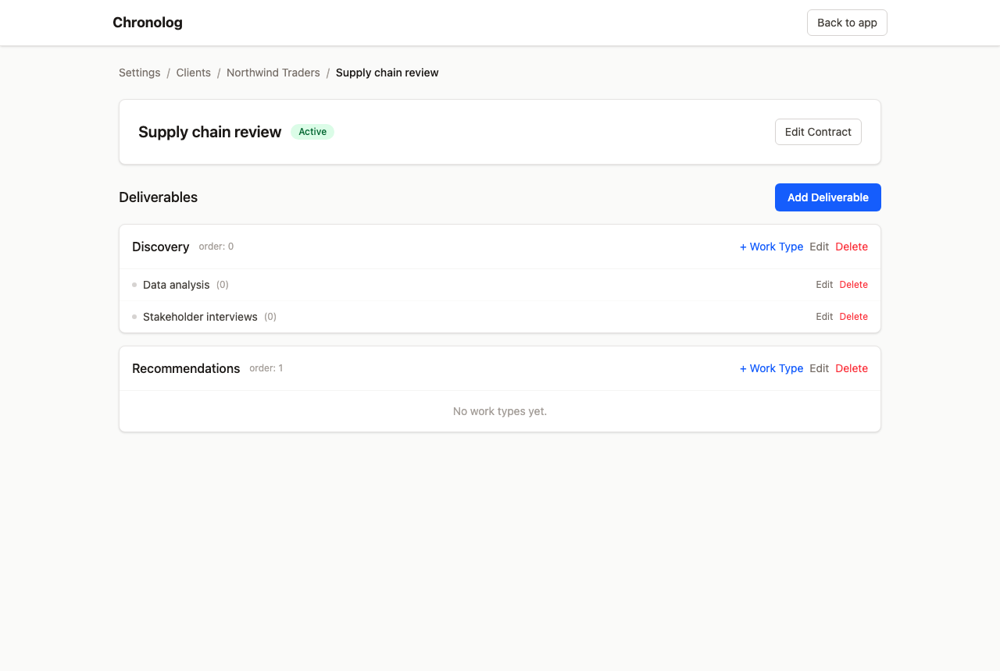

# Sprint 031-CL transcript: setting up a client from the CLI

Run on 2026-11-04 against the worktree dev server (`http://localhost:5209`, shared dev Postgres) as
the user `qa-031-manual-…@chronolog.test`, with a personal API token in a scratch config file
(`CHRONOLOG_CONFIG`; the token is never printed). stdin is not a terminal, as when Claude runs the
CLI, so `remove` without `--yes` refuses instead of asking.

## 1. Build the client top-down, with the guard rails

```
$ chronolog client add "Northwind Traders" --code NWT --emoji 🌬️
Created client NWT Northwind Traders  id=f87e6056-6e28-460c-8b46-327bea8e7e37
[exit 0]

$ chronolog client add "Northwind Again" --code NWT
chronolog: Short code “NWT” is already used by another client. Pick a different one.
[exit 5]

$ chronolog contract add NWT "Supply chain review" --description "Q4 review of the supplier base"
Created contract NWT/Supply chain review (Northwind Traders)  id=cbe4a1b3-bfb9-4247-adc6-3c65ba447500
[exit 0]

$ chronolog deliverable add "NWT/Supply chain review" Discovery
Created deliverable NWT/Supply chain review/Discovery  id=e00ac3fc-10fb-4a44-ade9-8b3af94633ae
[exit 0]

$ chronolog deliverable add "NWT/Supply chain review" Recommendations --order 1
Created deliverable NWT/Supply chain review/Recommendations  id=4e2a2656-9ed1-4a4c-a00b-c78efa5ca9e5
[exit 0]

$ chronolog work-type add "NWT/Supply chain review/Discovery" Interviews
Created work type NWT/Supply chain review/Discovery/Interviews  id=aecbd5ee-4ad1-4827-b74d-983a6f4cb9cd
[exit 0]

$ chronolog tag add "NWT/Supply chain review/Discovery" "Data analysis"
Created work type NWT/Supply chain review/Discovery/Data analysis  id=413ed70e-063d-4746-bd72-ff01490b4355
[exit 0]

$ chronolog deliverables "NWT/Supply chain review"
Deliverables of NWT/Supply chain review: 2
  0  Discovery  id=e00ac3fc-10fb-4a44-ade9-8b3af94633ae
  1  Recommendations  id=4e2a2656-9ed1-4a4c-a00b-c78efa5ca9e5
[exit 0]

$ chronolog tags "NWT/Supply chain review/Discovery"
Work types of NWT/Supply chain review/Discovery: 2
  0  Interviews  id=aecbd5ee-4ad1-4827-b74d-983a6f4cb9cd
  0  Data analysis  id=413ed70e-063d-4746-bd72-ff01490b4355
[exit 0]

$ chronolog log "NWT/Supply chain review" 2h "Supplier interviews, round 1" --date 2026-11-03 --deliverable Discovery --work-type Interviews
Logged 2h on 2026-11-03 to NWT/Supply chain review: Supplier interviews, round 1
id=9e0d0bfe-df64-4a09-a358-6f5a3a1ae73f
[exit 0]

$ chronolog work-type edit "NWT/Supply chain review/Discovery/Interviews" --name "Stakeholder interviews"
Saved work type NWT/Supply chain review/Discovery/Stakeholder interviews  id=aecbd5ee-4ad1-4827-b74d-983a6f4cb9cd
[exit 0]

$ chronolog contract edit "NWT/Supply chain review" --description none
Saved contract NWT/Supply chain review (Northwind Traders)  id=cbe4a1b3-bfb9-4247-adc6-3c65ba447500
[exit 0]

$ chronolog work-type edit "NWT/Supply chain review/Discovery/Workshops" --name x
chronolog: No work type matches “Workshops”.
  Data analysis  id=413ed70e-063d-4746-bd72-ff01490b4355
  Stakeholder interviews  id=aecbd5ee-4ad1-4827-b74d-983a6f4cb9cd
[exit 3]

$ chronolog client archive NWT
Archived client “Northwind Traders”. It is hidden from the sidebar and selects; its entries and notes are kept.
[exit 0]

$ chronolog clients
INTL     Internal  id=5b19c9c3-7144-4d76-9c7b-b2cec1d8abd0
[exit 0]

$ chronolog clients --all
INTL     Internal  id=5b19c9c3-7144-4d76-9c7b-b2cec1d8abd0
NWT      Northwind Traders [archived]  id=f87e6056-6e28-460c-8b46-327bea8e7e37
[exit 0]

$ chronolog client unarchive NWT
Restored client “Northwind Traders”. It is back in the sidebar and selects.
[exit 0]

$ chronolog contracts NWT
NWT/Supply chain review (Northwind Traders)  id=cbe4a1b3-bfb9-4247-adc6-3c65ba447500
[exit 0]

$ chronolog client remove NWT
chronolog: Client NWT “Northwind Traders” has 1 time entry (2h); removing it moves them to Deleted Client / Deleted Contract and deletes all its contracts, deliverables and work types.
Not removed: confirm with the owner, then run again with --yes (or archive instead).
[exit 2]

```

## 2. What the app shows (screenshots taken before the removal below)

- `01-sidebar.png`: the workspace sidebar lists Northwind Traders / Supply chain review; the
  timesheet card shows the entry logged with `Discovery > Stakeholder interviews` (the work type
  renamed after logging).
- `02-admin-clients.png`: Settings → Clients lists Northwind Traders (NWT) with its colour.
- `03-admin-client.png`: the client page lists the contract.
- `04-admin-contract.png`: the contract page shows Discovery (order 0) with Data analysis and
  Stakeholder interviews, and Recommendations (order 1).



## 3. Remove, after the owner says yes

```
$ chronolog client remove NWT --yes
Deleted “Northwind Traders”. 1 time entry (2h) moved to Deleted Client / Deleted Contract, each entry noting where it came from.
[exit 0]

$ chronolog clients --all
INTL     Internal  id=5b19c9c3-7144-4d76-9c7b-b2cec1d8abd0
[exit 0]

$ chronolog week 2026-W45
Week 2026-W45 (2026-11-02 to 2026-11-08): 3h30m, status Unsubmitted

Tue 2026-11-03  2h
      2h  _DELETED/Deleted Contract  Supplier interviews, round 1
Formerly: Northwind Traders / Supply chain review / Discovery / Stakeholder interviews

Wed 2026-11-04  1h30m
   1h30m  _DELETED/Deleted Contract  Wireframes
Formerly: Acme Ltd / Website rebuild / Phase 1 / Design
[exit 0]

```

The entry stays, on Deleted Client / Deleted Contract, with "Formerly: Northwind Traders / Supply
chain review / Discovery / Stakeholder interviews" in its description, exactly as a delete from the
admin page leaves it. (The Wireframes entry is from an earlier smoke run of the same commands.)
